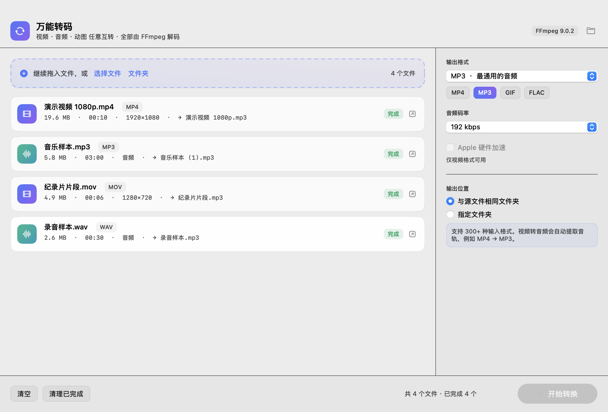
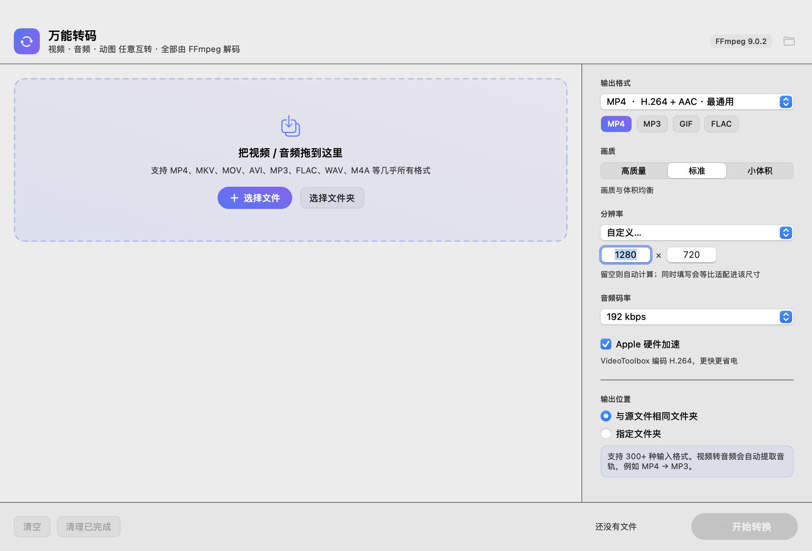

# 万能转码 · AnyConvert

一个原生 macOS 音视频格式转换器：**Swift + AppKit 界面 + 内置 FFmpeg 引擎**，拖入文件、选好格式、一键互转。
全部转换在本机完成，不联网、不上传。



## 功能

- **拖拽 / 选择文件 / 选择文件夹**（文件夹会递归扫描，跳过隐藏目录与 .app 包）
- **25 种输出格式**：13 种视频 + 12 种音频，输入格式由 FFmpeg 解码器全覆盖（300+ 种）
- **批量队列**：进度百分比、实时倍速、逐个转换、随时取消、失败可重试
- **画质三档**：高质量 / 标准 / 小体积（对应 x264 CRF 18/23/28）
- **分辨率**：保持原始、4K、1080p、720p、480p、360p，以及**自定义宽 × 高**
- **Apple 硬件加速**：VideoToolbox H.264 编码，失败自动回退软件编码
- **输出位置**：与源文件同目录，或指定文件夹；同名文件自动加序号，绝不覆盖
- 元数据保留、MP4/MOV faststart、GIF 两段式调色板优化、静音视频也能转

## 输出格式

| 类型 | 格式 | 编码 |
| --- | --- | --- |
| 视频 | MP4 / MOV / M4V | H.264 + AAC |
| 视频 | MKV | H.264 + AAC |
| 视频 | WebM | VP9 + Opus |
| 视频 | AVI | MPEG-4 + MP3 |
| 视频 | WMV | WMV2 + WMA |
| 视频 | FLV / TS | H.264 + AAC |
| 视频 | MPG | MPEG-2 + MP2 |
| 视频 | 3GP | H.264(baseline) + AAC |
| 视频 | OGV | Theora + Vorbis |
| 视频 | GIF | 动图（无声音，自动调色板） |
| 音频 | MP3 / M4A / AAC / WMA / AC3 / OPUS / OGG | 有损，可选码率 128/192/256/320 kbps |
| 音频 | WAV / FLAC / ALAC / AIFF / CAF | 无损 / PCM |

输入支持 FFmpeg 能解码的一切：MP4、MKV、MOV、AVI、WMV、FLV、WebM、TS、M2TS、MPG、VOB、3GP、OGV、RMVB、ASF、MXF、M4A、FLAC、WAV、APE、WV、AIFF、OPUS、AMR 等。

## 下载

- 最新版本：<https://github.com/Inkpaper-mz/AnyConvert/releases/latest>
- 1.0.0 直链（Apple 芯片）：[AnyConvert-1.0.0-macOS-arm64.dmg](https://github.com/Inkpaper-mz/AnyConvert/releases/download/v1.0.0/AnyConvert-1.0.0-macOS-arm64.dmg)
- Intel Mac：按下方「自行构建」使用 `ARCHS="arm64 x86_64"` 生成通用版本

## 安装

1. 打开 `dist/`，把 **万能转码.app** 拖到「应用程序」文件夹；
2. 双击运行。

> 本应用使用本地 ad-hoc 签名。若系统提示「无法验证开发者」，请在 Finder 中 **右键 → 打开** 一次即可（之后正常双击）。

## 使用

1. 把视频/音频拖进窗口（或点「选择文件 / 选择文件夹」）；
2. 右侧选择输出格式，例如把 `.mp4` 转成 `MP3`；
3. 点「开始转换」，完成后点每行的「完成」徽章可在 Finder 中定位文件。

快捷键：`⌘O` 添加文件 · `⇧⌘O` 添加文件夹 · `⌘↩` 开始转换 · `⌘.` 取消 · `⇧⌘R` 打开输出文件夹

### 自定义分辨率



分辨率选择「自定义…」后：

- 只填**宽** → 按宽度等比缩放（高度自动，保证偶数像素）
- 只填**高** → 按高度等比缩放（例如填 `720` 得到 720p）
- 两个都填 → **等比适配**进该尺寸框内，不拉伸变形
- 留空 → 不缩放

## 项目结构

```
AnyConvert/
├── Package.swift                    # SwiftPM 工程（macOS 13+，无第三方依赖）
├── Sources/AnyConvert/
│   ├── main.swift                   # 入口（含 --selftest / --print-env）
│   ├── App/AppDelegate.swift        # 窗口、主菜单
│   ├── AppModel.swift               # 队列、设置、持久化、转换调度
│   ├── Models.swift                 # 格式目录、画质、分辨率、任务模型
│   ├── CommandBuilder.swift         # 设置 → FFmpeg 参数的纯函数
│   ├── Engine.swift                 # 进程执行、进度解析、取消
│   ├── MediaProbe.swift             # ffprobe 解析时长/分辨率/轨道
│   ├── Toolchain.swift              # 定位内置/系统 FFmpeg
│   ├── FileUtilities.swift          # 目录展开、输出命名
│   └── UI/                          # AppKit 界面（自定义绘制）
├── Resources/Info.plist
├── scripts/build.sh                 # 打包 .app（图标、内置引擎、签名）
├── scripts/make_icon.swift          # 用 CoreGraphics 生成 .icns
└── vendor/                          # 静态 FFmpeg 二进制（arm64 / intel）
```

引擎查找顺序：`App/Contents/Resources/bin/ffmpeg-<arch>` → `$ANYCONVERT_BIN` → 工程 `vendor/` → `/opt/homebrew/bin` → `/usr/local/bin` → `PATH`。
所以即使不打包，`swift run` 也能直接使用。

## 自行构建

需要 macOS 13+ 与 Xcode Command Line Tools（Swift 5.9+）。

```bash
# 1. 下载内置转码引擎（arm64；带 WITH_INTEL=1 可同时下载 Intel 版）
./scripts/fetch_ffmpeg.sh

# 2. 仅当前架构（Apple 芯片，约 127 MB）
./scripts/build.sh

# 通用二进制（Intel + Apple 芯片）
ARCHS="arm64 x86_64" ./scripts/build.sh

# 额外产出 DMG
DMG=1 ./scripts/build.sh
```

> 国内网络下载较慢时可加代理：`PROXY=http://127.0.0.1:7890 ./scripts/fetch_ffmpeg.sh`

自检（会把 25 种格式各转一遍并校验输出）：

```bash
swift build -c release
./.build/release/AnyConvert --selftest
# 或对已打包的 App：
"dist/万能转码.app/Contents/MacOS/AnyConvert" --selftest
```

## 许可

- 本项目的界面与业务代码：**MIT License**（见 `LICENSE`）
- 转码引擎：**FFmpeg**（GPL v3），静态构建来自 <https://ffmpeg.martin-riedl.de/>
  重新分发 App 时请遵守 GPL v3 的相应义务（提供源码获取方式与许可声明）。
- 图标由 `scripts/make_icon.swift` 生成，随项目一同按 MIT 授权。
