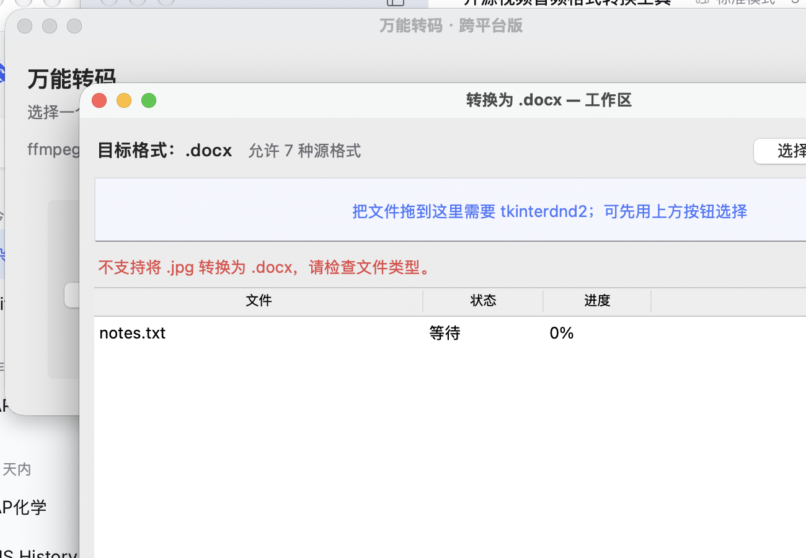
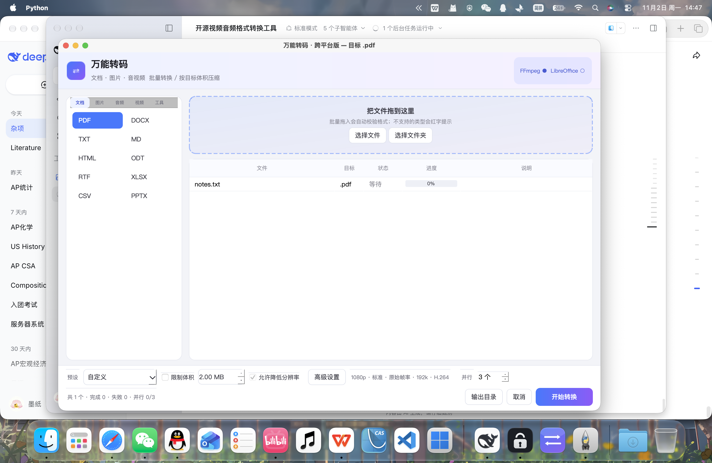

# 跨平台桌面版（Python + PySide6/Qt）

把「转换矩阵 + 校验拦截 + 并发队列 + 引擎调度 + 目标格式工作区」做成了一个可直接运行的子工程，
用于 Windows / macOS / Linux，也是后续接原生 UI 或 CLI 的参考实现。



## 结构

```
crossplatform/
├── core/
│   ├── matrix.json       # 转换矩阵（目标格式 → 源白名单 + 引擎）
│   ├── matrix.py         # 矩阵加载、扩展名归一化、校验、引擎选择
│   ├── engines.py        # FFmpeg / LibreOffice / pdf2docx 调度
│   └── queue.py          # 校验入队 + ThreadPoolExecutor(3) + 进度/取消
├── ui/
│   └── app.py            # Tkinter：目标格式标签页 → 独立工作区 → 批量拖拽
├── tests/
│   └── test_core.py      # 9 个单测（矩阵/并发/引擎）
└── requirements.txt      # 仅 tkinterdnd2（可选，用于拖拽）
```

## 界面

主界面：左侧「文档 / 图片 / 音频 / 视频 / 工具」五个标签页（共 43 种目标格式），中间拖拽区 + 任务表，
底部预设、目标体积、允许降低分辨率、**高级设置**、**并行数量（1–8，默认 3）**、输出目录。

高级设置包含：分辨率（预设 / 自定义宽高）、画质、帧率、音频码率、视频编码（H.264 / H.265 / AV1），
会直接映射到 FFmpeg 参数（已用 320×240@30fps 的单测验证）。



## 运行

```bash
# 1) 依赖
python3 -m pip install --user tkinterdnd2    # 可选：启用真正的拖拽
# 文档转换需要 LibreOffice；PDF→Word 建议再装 pdf2docx
python3 -m pip install --user pdf2docx

# 2) 启动
cd <repo>
python3 -m pip install --user PySide6-Essentials
python3 -m crossplatform.qt.app

# 3) 测试
python3 -m unittest discover -s crossplatform/tests -v
```

引擎查找顺序：

- ffmpeg：`$FFMPEG` → PATH → `vendor/ffmpeg` → `vendor/intel/ffmpeg` → Homebrew/系统路径
- LibreOffice：`$SOFFICE` → PATH → `/Applications/LibreOffice.app/.../soffice` → Linux/Windows 常见路径

找不到引擎时会抛 `EngineUnavailable`，UI 显示可读提示，不会崩溃。

## 按目标体积压缩

工作区顶部的「目标大小 (MB)」留空 = 普通转换；填写后走压缩管线：

- **图片**：对质量做二分（JPEG qscale / WebP quality / AVIF CRF），仍超标就逐级降分辨率再二分；PNG 无损，只能靠缩放逼近
- **视频**：`总码率 = 目标字节×8 / 时长 − 音频码率 − 容器余量`，x264 两遍编码；体积仍超标按比例回退码率重压（最多 3 次）
- **达不到目标**：抛 `TargetUnreachable`，提示「无法压缩到 X MB：当前参数下最小约 Y MB」，不会把半成品留给用户

```bash
python3 -m unittest crossplatform.tests.test_compress -v
```

## 交互规则

1. 主窗口按「文档 / 图片 / 音视频」分组列出目标格式；点击 `.docx` 等按钮打开独立工作区窗口。
2. 工作区支持批量拖入（tkinterdnd2）或按钮选择文件/文件夹。
3. **拖入即校验**：`matrix.validate(target, path)`，不在白名单的文件直接拒绝，红字提示
   `不支持将 .jpg 转换为 .docx，请检查文件类型。`，不会进入队列。
4. 队列 `ThreadPoolExecutor(max_workers=3)`，并行上限 3；每个任务独立进度、可取消；失败自动删除半成品。

## 引擎与工具

| 引擎 | 用途 | 来源 |
| --- | --- | --- |
| FFmpeg | 音视频 / 图片 / GIF / 提取音频 / 压缩 | 随软件自带（vendor） |
| LibreOffice 26.8.2 | Word/Excel/PPT/ODT ↔ PDF 等文档互转 | 随软件自带（vendor，约 800 MB） |
| PyMuPDF | PDF→图片/文本/表格、图片→PDF、合并、拆分 | pip 依赖，随包打包 |
| OCR | 图片/扫描件 → TXT | macOS 用系统 Vision（零安装）；其他平台回退 Tesseract |

准备自带引擎（新机器/重新打包时）：

```bash
python3 scripts/fetch_engines.py --all   # 下载 LibreOffice + FFmpeg 到 crossplatform/vendor
```

打包成 macOS .app（引擎一起装进去）：

```bash
bash scripts/package_macos.sh            # 产出 dist/万能转码.app
```

「工具」标签提供：合并 PDF、拆分 PDF、PDF 转图片（ZIP）、PDF 表格转 Excel、图片转 PDF、打包 ZIP（级别 0–9）。

## 命令行（批处理 / 右键菜单 / 自动化）

```bash
python3 -m crossplatform.cli convert -i a.mp4 --to mp3 --json
python3 -m crossplatform.cli convert -i big.jpg --to jpg --target-size 2 --json
python3 -m crossplatform.cli convert -i a.mp4 --to mp4 --resolution 1080 --fps 30 --codec h265
python3 -m crossplatform.cli merge-pdfs a.pdf b.pdf -o out.pdf
python3 -m crossplatform.cli split-pdf a.pdf -d out/
python3 -m crossplatform.cli pdf-images a.pdf -d out/ --dpi 200
python3 -m crossplatform.cli pdf-tables a.pdf -o tables.xlsx
python3 -m crossplatform.cli zip a.png b.txt -o pack.zip --level 9
python3 -m crossplatform.cli capabilities --json
```

这套 CLI 可以直接挂到右键菜单（macOS Quick Action / Windows 注册表 / Linux Nautilus 脚本）。

## 转换矩阵

`core/matrix.json` 一项对应一个目标格式：

```json
"pdf": {
  "category": "document",
  "engine": "libreoffice",
  "sources": ["docx", "doc", "odt", "rtf", "txt", "md", "html", "epub",
              "jpg", "jpeg", "png", "webp", "tiff", "tif", "bmp"]
}
```

规则：

- 目标不在矩阵 → 拒绝
- 源扩展名不在 `sources` → 拒绝（提示语固定格式）
- 文件不存在 / 为空 / 不是文件 → 拒绝
- 扩展名别名（`jpeg→jpg`、`tif→tiff`、`htm→html`、`mpeg→mpg`）自动归一化
- 引擎选择：目标声明 `libreoffice`，或来源是文档/PDF 语义（pdf/docx/doc/odt/rtf/txt/md/html/epub）→ LibreOffice；其余交 FFmpeg

新增一个目标格式：在 `matrix.json` 加一项即可，UI 会自动出现对应按钮（`GROUPS` 里登记分组）。

## 引擎说明

| 引擎 | 覆盖 | 备注 |
| --- | --- | --- |
| FFmpeg | 音视频、图片、GIF | 使用 `-progress pipe:1` 解析进度；图片输出 `-frames:v 1 -update 1`；GIF 走 palettegen/paletteuse |
| LibreOffice | 文档互转、图片→PDF、PDF→图 | `--headless` + 独立 `-env:UserInstallation` 临时 profile，避免并发锁冲突 |
| pdf2docx（可选） | PDF → DOCX | 版面还原明显优于 LibreOffice 的 PDF 导入；未安装时自动回退 |

已知限制：

- LibreOffice 导入 PDF 的结构还原有限（多栏、扫描件、公式），这类文件建议装 `pdf2docx`。
- 扫描版 PDF 需要 OCR，本子工程未内置（可后续接 Tesseract）。
- 图片 → PDF 走 LibreOffice Draw，复杂透明/多图排版可能与预期有差异。

## 与 macOS 主工程的关系

- 两边**共用同一份矩阵语义**：Swift 版 `availableFormats` / `ensureValidFormat` 与这里的 `validate` 规则一致。
- Python 版独立运行，用于 Windows/Linux 或作为参考实现；不修改 Swift 工程即可验证业务规则。
- 若要并入 Swift App：把 `matrix.json` 拷进 `Resources/`，在 `CommandBuilder` 前做同样的白名单校验即可（见 `docs/ARCHITECTURE.md`）。
